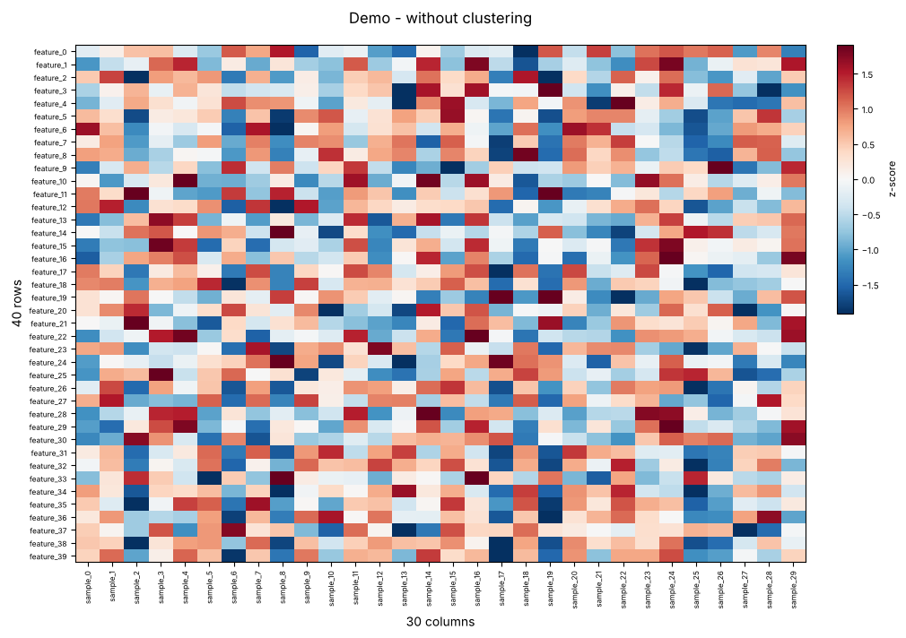
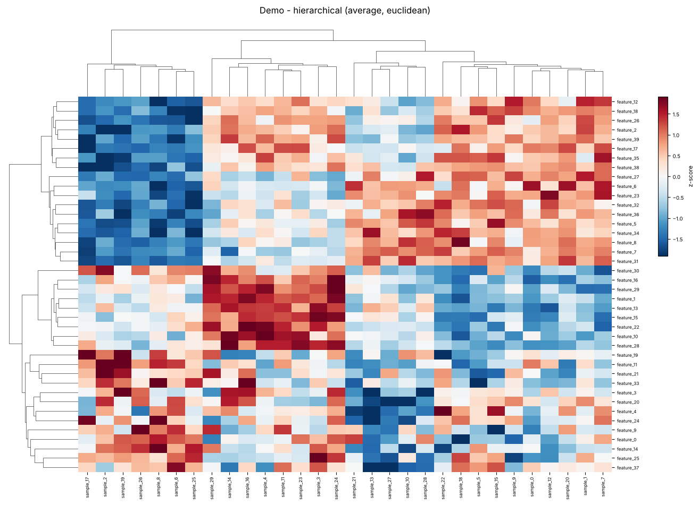
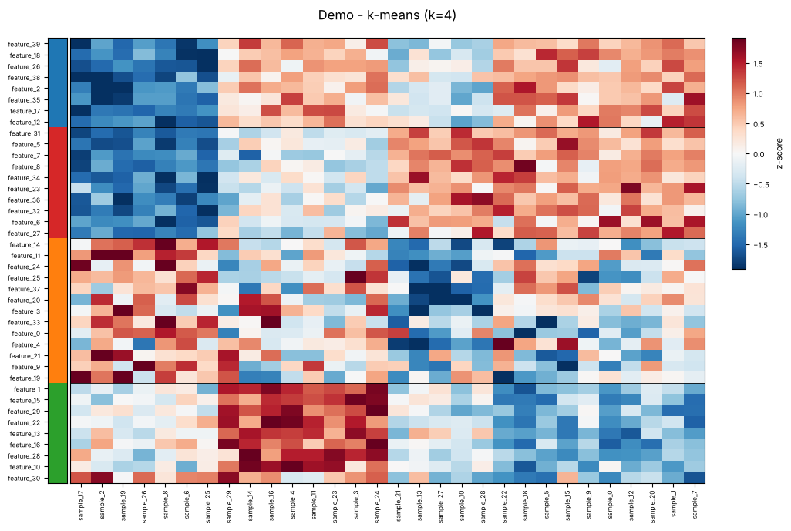

# Heatmap Portal

A browser app and a command-line script for drawing heatmaps of large tables, both **without clustering** (original order) and **with clustering** (hierarchical or k-means).

- Load **CSV, TSV, TXT or Excel** files
- **Hierarchical clustering** with 7 linkage methods × 8 distance metrics, or **k-means** for 100,000+ rows
- Any matplotlib **colour map**, or your own colour gradient
- **Row and column names** shown, with the plot enlarged so names don't overlap
- **Colour legend** to the right of the plot or on top, never over the heatmap
- Download as **PNG, PDF, SVG or TIFF**, plus cluster assignments as **CSV**

| Without clustering | Hierarchical clustering | K-means clustering |
| :---: | :---: | :---: |
|  |  |  |

---

## Contents

- [Files](#files)
- [Quick start](#quick-start)
- [Install on Windows (PowerShell)](#install-on-windows-powershell)
- [Install on Ubuntu / Linux / macOS](#install-on-ubuntu--linux--macos)
- [Using the portal](#using-the-portal)
- [Options reference](#options-reference)
- [Command-line script](#command-line-script)
- [Tips for large data](#tips-for-large-data)
- [Troubleshooting](#troubleshooting)

---

## Files

| File | What it is |
| --- | --- |
| `heatmap_portal.py` | Browser app (Streamlit): browse a file, pick options, plot, download |
| `heatmap_plotter.py` | Command-line script: same plots, saved straight to a folder |
| `requirements.txt` | Python packages needed |
| `docs/` | Example images used in this README |

---

## Quick start

```bash
git clone https://github.com/<your-username>/heatmap-portal.git
cd heatmap-portal
python -m pip install -r requirements.txt
python -m streamlit run heatmap_portal.py
```

Your browser opens at **http://localhost:8501**. Pick **Demo data** to try it right away.

> Use `python -m streamlit run`, not just `streamlit run`. The short form fails with
> *"streamlit is not recognized"* (Windows) or *"command not found"* (Linux) when
> Python's Scripts folder isn't on your PATH. `python -m` always works.

No Git? On the GitHub page click **Code → Download ZIP**, unzip it, and open a terminal in that folder.

---

## Install on Windows (PowerShell)

**1. Check Python** (3.9 or newer). If neither command prints a version, install Python from [python.org](https://www.python.org/downloads/) and tick **"Add python.exe to PATH"** during setup.

```powershell
py --version
python --version
```

**2. Get the code**

```powershell
git clone https://github.com/<your-username>/heatmap-portal.git
cd heatmap-portal
```

**3. Install packages** (once)

```powershell
py -m pip install -r requirements.txt
```

**4. Start the portal** (each time)

```powershell
py -m streamlit run heatmap_portal.py
```

If `py` is not found, use `python` in its place. With Anaconda, run the same commands in **Anaconda Prompt** using `python`.

<details>
<summary><b>Optional: use a separate environment</b></summary>

```powershell
py -m venv .venv
.\.venv\Scripts\Activate.ps1
python -m pip install -r requirements.txt
python -m streamlit run heatmap_portal.py
```

If activation says *"running scripts is disabled on this system"*, run this once, then try again:

```powershell
Set-ExecutionPolicy -Scope CurrentUser RemoteSigned
```
</details>

---

## Install on Ubuntu / Linux / macOS

**1. Install Python tools** (Ubuntu/Debian, once)

```bash
sudo apt update
sudo apt install python3 python3-pip python3-venv git
```

On macOS, install Python from [python.org](https://www.python.org/downloads/) or with `brew install python`.

**2. Get the code and create an environment** (once)

Ubuntu 23.04 and newer refuse `pip install` outside an environment (*externally-managed-environment* error), so create one:

```bash
git clone https://github.com/<your-username>/heatmap-portal.git
cd heatmap-portal
python3 -m venv .venv
source .venv/bin/activate
python -m pip install -r requirements.txt
```

**3. Start the portal** (each time)

```bash
cd heatmap-portal
source .venv/bin/activate
python -m streamlit run heatmap_portal.py
```

To stop the portal on any system, close the browser tab and press **Ctrl + C** in the terminal.

---

## Using the portal

### 1. Load data

Put one item per row (gene, feature, sample) and numbers in the columns. Row names go in the first column, column names in the first row:

```csv
Gene,Control_1,Control_2,Treated_1,Treated_2
GeneA,5.2,5.0,8.9,9.1
GeneB,3.1,3.3,1.2,1.0
GeneC,7.4,7.1,7.5,7.2
```

| Source | When to use |
| --- | --- |
| **Browse / upload file** | Normal use: click *Browse files* or drag a file in |
| **Local file path** | Very large files: paste the full path, e.g. `C:\data\expr.csv` |
| **Demo data** | Try the portal with 3,000 generated rows × 30 columns |

Check the **Delimiter**, **First row = column names**, **First column = row names** and (for Excel) **sheet** options, then look at **Preview data**. In **Numeric columns to plot**, remove columns you don't want.

### 2. Choose options

All options are in the left sidebar (click **>** at the top left if it's hidden). The defaults suit most data. See the [Options reference](#options-reference).

### 3. Plot and download

1. Under **Show**, pick *Both*, *Without clustering only* or *With clustering only*.
2. Click **Plot heatmaps**.
3. Switch between the **Without clustering** and **With clustering** tabs.
4. Use the **Download PNG / PDF / SVG / TIFF** buttons under each plot.
5. In the clustering tab, **Download clusters CSV** saves each row's order and cluster number.

Change any option and click **Plot heatmaps** again to redraw.

---

## Options reference

### Preprocessing

| Option | What it does | Typical choice |
| --- | --- | --- |
| Scaling | `z-score rows` compares patterns across columns; `z-score columns` scales each sample; `min-max rows` rescales each row to 0–1; `none` keeps raw values | z-score rows |
| log2(x + 1) | Compresses large values | On for raw counts |
| Missing values | Fill with row mean, fill with 0, or drop rows | Fill row mean |
| Top-N most variable rows | Keep the N rows that vary most (0 = all) | 1,000–5,000 for big data |
| Random subsample | Keep N random rows (0 = all) | 0 |
| Clip values to ± | Cap extreme values (0 = off) | 3 for z-scores |
| Transpose | Swap rows and columns | Off |

### Clustering

| Option | Choices |
| --- | --- |
| Algorithm | **Hierarchical** (dendrograms, up to ~15,000 rows) or **K-means** (100,000+ rows) |
| Linkage method | `average`, `complete`, `single`, `weighted`, `ward`, `centroid`, `median` |
| Distance metric | `euclidean`, `correlation`, `cosine`, `cityblock`, `chebyshev`, `braycurtis`, `canberra`, `sqeuclidean`. `ward`, `centroid` and `median` allow euclidean only |
| Cluster | rows, columns, or both |
| Number of clusters k | Groups for k-means, or where to cut the tree for the cluster table |
| Max rows for hierarchical | Above this, the portal switches to k-means automatically |

### Colours

| Option | What it does |
| --- | --- |
| Colormap | `RdBu_r`, `coolwarm`, `bwr`, `vlag` for data centred on 0; `viridis`, `magma`, `YlOrRd` for values that only go up; every matplotlib colour map is listed |
| Custom colour gradient | Pick 2–5 colours with colour pickers |
| Reverse colours | Flip the colour map |
| Centre colour scale | Put the middle colour at a value (0 for z-scores) |
| Robust limits | Use the 2nd–98th percentiles so outliers don't wash out colours |
| Set min / max manually | Fix the range so several plots are comparable |

### Layout and export

| Option | What it does |
| --- | --- |
| Colour legend position | **Right (vertical)**, placed beyond the row names, or **Top (horizontal)**, placed above the plot. Never over the heatmap |
| Row names / Column names | `Show all` (default), `Auto` (hide above a count), `Hide` |
| Enlarge plot so names don't overlap | Grows the plot so each name gets its own line (up to ~2,200 rows at font 6) |
| Title, colour-bar label, width, height, font size | Plot text and size (0 = automatic size) |
| Download DPI | 150, 300 (papers) or 600 (posters) |
| Download formats | png, pdf, svg, tiff |

---

## Command-line script

`heatmap_plotter.py` makes the same plots without a browser and saves them to a folder (`heatmaps/` by default). Each run saves the plot without clustering plus one clustered plot per method × metric × colour map.

```bash
# try it
python heatmap_plotter.py --demo

# your file, z-score by row
python heatmap_plotter.py -i data.csv --scale row

# several clustering methods and metrics
python heatmap_plotter.py -i data.csv --methods average ward complete --metrics euclidean correlation

# several colour maps, or a custom gradient
python heatmap_plotter.py -i data.csv --cmaps viridis RdBu_r magma --center 0
python heatmap_plotter.py -i data.csv --custom-colors navy white firebrick

# very large data
python heatmap_plotter.py -i big.csv --methods kmeans --k 8 --top-n 20000

# Excel, PDF + PNG at 600 dpi
python heatmap_plotter.py -i data.xlsx --sheet Sheet1 --formats png pdf --dpi 600
```

Run `python heatmap_plotter.py --help` to see every option, and `--list-cmaps` for all colour map names.

---

## Tips for large data

| Rows | Recommended |
| --- | --- |
| Up to 5,000 | Any option |
| 5,000 – 15,000 | Hierarchical works but is slower; consider Top-N = 5,000 |
| 15,000 – 100,000 | Top-N (2,000–10,000) for dendrograms, or k-means on all rows |
| Over 100,000 | K-means, or Top-N / subsample first; load with *Local file path* |

- Hierarchical clustering needs memory that grows with rows²: about 1 GB for 15,000 rows and 4 GB for 30,000.
- Showing thousands of row names is slow (30–60 s for 3,000 names). Set **Row names** to *Auto* for quick previews.
- For tall plots, the page preview is shrunk. Download **PDF** or **SVG** to read every name at any zoom.
- Files over 200 MB: start with `python -m streamlit run heatmap_portal.py --server.maxUploadSize 2000` (in MB).

---

## Troubleshooting

| Problem | Fix |
| --- | --- |
| `streamlit is not recognized` / `command not found` | Use `python -m streamlit run heatmap_portal.py` (Windows: `py -m streamlit run ...`) |
| `ModuleNotFoundError` | `python -m pip install -r requirements.txt` |
| `externally-managed-environment` (Ubuntu) | Use a virtual environment ([Ubuntu install](#install-on-ubuntu--linux--macos)) |
| PowerShell: *running scripts is disabled* | `Set-ExecutionPolicy -Scope CurrentUser RemoteSigned` |
| Excel file won't open | `pip install openpyxl` (.xlsx) or `pip install xlrd` (old .xls) |
| All data in one column | Change **Delimiter** from auto to comma, tab, semicolon or space |
| "Select at least 2 numeric columns" | Numbers were read as text; fix decimal commas in the file, or untick *First column = row names* |
| "No data left after preprocessing" | Switch *Missing values* from *drop rows* to *fill row mean* |
| Slow or crashes when clustering | Lower Top-N, use k-means, or lower *Max rows for hierarchical* |
| Washed-out colours | Turn on *Robust limits*, or set *Clip values to ±* = 3 |
| Row names overlap | Lower the font size or use Top-N rows (the portal warns when names can't fit) |
| Port 8501 in use | `python -m streamlit run heatmap_portal.py --server.port 8502` |
| Download clears the page | Update Streamlit: `python -m pip install -U streamlit` (1.43+) |

---

## Upload this project to your GitHub

1. On GitHub click **New repository**, name it `heatmap-portal`, and click **Create repository** (leave "Add a README" unticked).
2. In a terminal inside this folder:

```bash
git init
git add .
git commit -m "Heatmap portal"
git branch -M main
git remote add origin https://github.com/<your-username>/heatmap-portal.git
git push -u origin main
```

3. Replace `<your-username>` in this README with your GitHub username.
